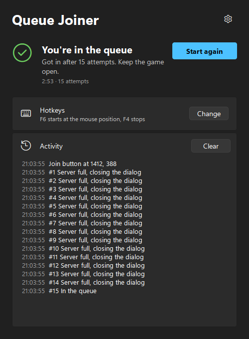
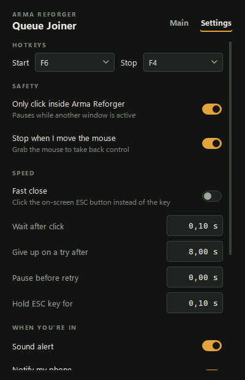

# Arma Reforger Queue Joiner

Keeps pressing **Join** on a full Arma Reforger server until you get into the queue, then tells you with a sound, a Windows notification and, if you like, a push to your phone or a Discord message. When the queue lets you in and the game has loaded the server, you get a second alert, so you can leave the PC while you wait.

[](https://github.com/micorytican/arma-queue-joiner/actions/workflows/ci.yml)


<p>
  
  
</p>

## Download

From the [Releases](https://github.com/micorytican/arma-queue-joiner/releases) page:

- **ArmaQueueJoiner-x.y.z-setup.exe** installs for your user only (no admin rights) and adds a Start menu entry. Starts faster.
- **ArmaQueueJoiner.exe** is portable. Put it anywhere and run it.

Windows SmartScreen may warn that the publisher is unknown, because the app is not code-signed. Choose *More info › Run anyway*.

## How to use

1. In Arma Reforger, open the server browser and pick a full server.
2. Hover the mouse over **Join**.
3. Press **F6**, or click **Start** in the app and move the mouse to Join within 3 seconds.
4. Leave the mouse alone. The app clicks Join, closes the "server full" dialog and tries again.
5. When you are in the queue it stops and alerts you. Keep the game open.
6. When the queue lets you in, the app alerts you again once you are in the game. If the server drops you from the queue, you get told that too.

Press **F4** to stop at any time. Moving the mouse also stops it, so you can always take back control.

## Features

- **Looks and feels like Windows 11.** Follows your light or dark mode and your accent colour.
- **English and Ukrainian.** Starts in Ukrainian on a Ukrainian Windows and in English everywhere else; change it in Settings.
- **Safe by default.** Clicks only while Arma Reforger is the active window and stops when you move the mouse.
- **Alerts:** sound, Windows notification, phone push through the free [ntfy](https://ntfy.sh) app, Discord message through a webhook.
- **Knows when you are in.** After the queue it follows the game's own log and alerts you when you are on the server, with the server name.
- **Diagnostics page** shows what the app sees on screen right now, so you can tell why it does or does not react.
- **Any resolution.** Detection scales with the screen size.
- **Update check** against GitHub Releases at startup (can be turned off).

## Settings

| Setting | Default | What it does |
|---|---|---|
| Start / Stop hotkey | F6 / F4 | Start uses the mouse position at that moment |
| Only click inside Arma Reforger | On | Pauses while another window is in front |
| Stop when I move the mouse | On | Lets you take over at once |
| Fast close | Off | Clicks the on-screen ESC button instead of pressing the key; falls back to the key |
| Timing | 0.10 / 8.00 / 0.00 / 0.10 s | Wait after clicking Join, retry if nothing happens after, pause between attempts, ESC hold |
| When I get into the queue | On | Alert as soon as the queue screen shows |
| When I'm in the game | On | Alert when the queue has let you in and the server has loaded |
| Play a sound | On | Three short beeps |
| Notify my phone | Off | Push through ntfy, see below |
| Post to Discord | Off | Message to a channel through a webhook, see below |
| Language | English (Ukrainian on a Ukrainian Windows) | English or Ukrainian |
| Keep on top / Close to the tray | Off / On | Window behaviour |
| Check for updates | On | One request to GitHub at startup, nothing else is sent |

Settings live in `%APPDATA%\ArmaQueueJoiner\settings.json`. Settings from 1.x are carried over.

### Phone notifications (ntfy)

1. Install **ntfy** on your phone (Android or iOS).
2. Turn on **Notify my phone**. A random topic name is filled in.
3. Subscribe to that topic in ntfy and press **Send test**.

Anyone who knows the topic name can read its messages, so keep it hard to guess.

**iPhone:** if a notification only shows up after you open ntfy, delete the subscription in ntfy and add the same topic again, then press **Send test**. Also check that ntfy is allowed to show banners and that Background App Refresh is on.

### Discord

1. In Discord open the channel settings › **Integrations** › **Webhooks** › **New webhook** › **Copy webhook URL**.
2. Turn on **Post to Discord**, paste the link and press **Send test**.

## Troubleshooting

Open **Settings › Diagnostics**. It shows the active window, your display, how much "server full" red and queue yellow the app sees, and a picture of the scanned area.

| Problem | What to do |
|---|---|
| Status stays on *Waiting for the Arma Reforger window* | Click into the game. If Diagnostics says *Not Arma Reforger* while the game is in front, turn off *Only click inside Arma Reforger* and report it. |
| Nothing is clicked | If Arma Reforger runs as administrator, run the app as administrator too. Windows blocks input from normal apps to elevated ones. |
| A hotkey does not work | Another program uses it. Settings shows a message; pick a different key. |
| No alert when I get into the game | Diagnostics shows *Game log*. If it says *Not found*, your Documents folder is somewhere unusual; report it with the Diagnostics report. |
| It never detects the queue or the full dialog | Open the dialog in game, check the values on the Diagnostics page and include **Copy report** in a bug report. |

**Reporting a bug:** open an [issue](https://github.com/micorytican/arma-queue-joiner/issues), paste the Diagnostics report (it leaves out your ntfy topic and Discord link) and attach the newest `aqj.log` from **Diagnostics › Open log folder**.

## How it works

The app looks at two small parts of the screen and never reads game memory or network traffic:

- the centre-left dialog area: red means "server full"; yellow text that stays for 3 seconds means you are in the queue;
- the bottom-left area, only for Fast close, to find the ESC button.

It moves the mouse and presses keys the same way you would.

After the queue it reads the game's own log file, `Documents\My Games\ArmaReforger\logs\logs_<date>\console.log`, to see when you have joined the server or been dropped from the queue. It only reads new lines, never changes the file and stops after you are in, after you press Start again, or after 3 hours.

## For developers

Requirements: Windows 10 or 11, Python 3.13.

```bash
git clone https://github.com/micorytican/arma-queue-joiner.git
cd arma-queue-joiner
py -3.13 -m venv .venv
.venv\Scripts\pip install -r requirements-dev.txt
.venv\Scripts\python app.py
```

Everything installs into `.venv` inside the project.

| Task | Command |
|---|---|
| Run tests | `.venv\Scripts\python -m pytest` |
| Lint and format | `.venv\Scripts\ruff check .` and `.venv\Scripts\ruff format .` |
| Type check | `.venv\Scripts\basedpyright` |
| Portable exe | `build.bat` |
| Portable exe and installer | `build.bat all` (needs [Inno Setup 6](https://jrsoftware.org/isinfo.php)) |

See [docs/TESTING.md](docs/TESTING.md) for the test layers and the manual in-game checklist.

### Releasing

1. Bump `__version__` in `aqj/__init__.py` and add a section to `CHANGELOG.md`.
2. Commit, then tag and push: `git tag v2.0.1 && git push origin v2.0.1`.
3. The *Release* workflow runs the checks, builds both executables and publishes the GitHub release with the changelog section as notes.

### Project layout

```
aqj/
  joiner.py      the join loop (pure logic, tested with fakes)
  detection.py   pixel analysis
  screen.py      screen capture (mss)
  winapi.py      mouse, keyboard and window calls
  hotkeys.py     global hotkeys via RegisterHotKey
  notify.py      sound, ntfy and Discord
  updates.py     GitHub release check
  net.py         small HTTP helper
  logs.py        log file and crash handler
  i18n.py        English and Ukrainian text
  settings.py    load, validate and save settings
  ui/            window, Fluent-style widgets and theme
tests/           pytest and pytest-qt suites
tools/           build helpers (version resource, release notes)
installer/       Inno Setup script
```

## License

MIT, by lime98 aka micorytican.
